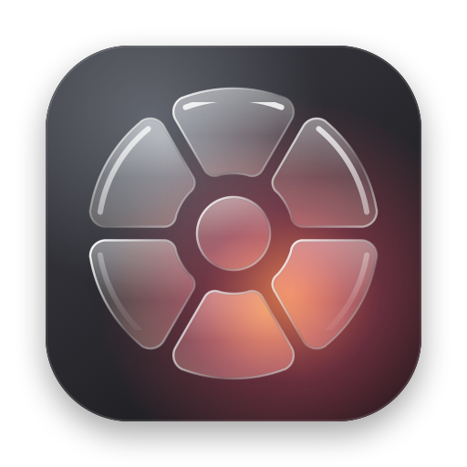
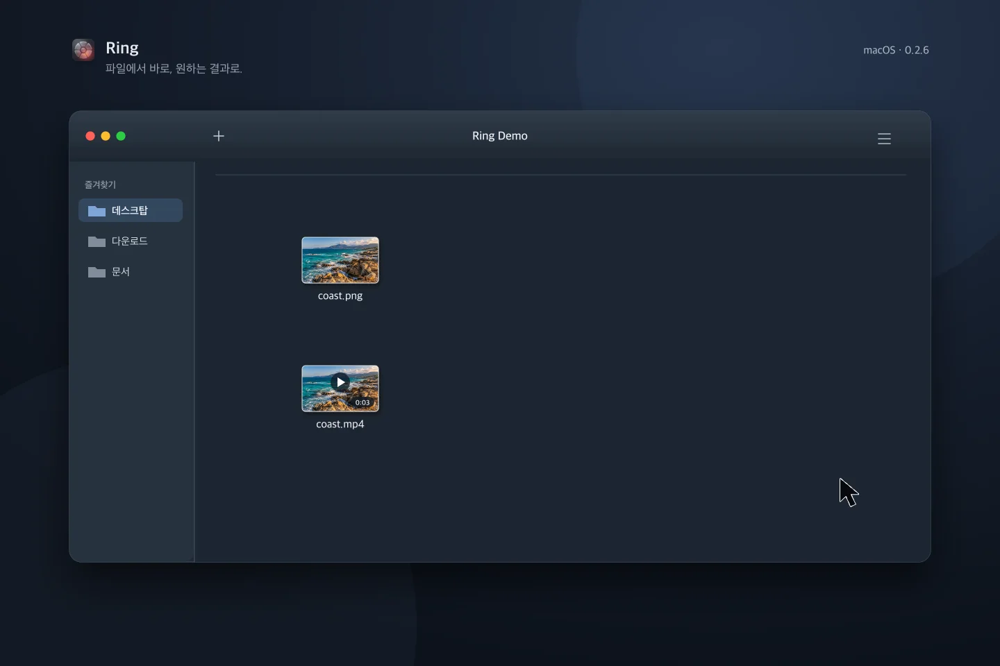

# Ring

파일 우클릭으로 여는 가벼운 macOS 변환·편집 앱

파일을 우클릭하고 링에서 형식을 고르면 같은 폴더에 새 파일로 저장돼요.

이미지는 **JPG**, 영상은 **WebP**로. 영상 변환 창에서 **긴 변 480px**처럼 크기를 바꾼 뒤 저장할 수 있습니다.
원본은 유지하고 결과는 같은 폴더에 새 파일로 저장합니다. 위 시연은 변환 대기 구간을 빠르게 재생합니다.

이 배포본은 FFmpeg의 GPL 구성과 x264·x265를 정적으로 포함합니다. Ring은 [GPLv2](LICENSE)로 배포하며, 완전한 대응 소스 묶음은 각 릴리즈의 `Ring-버전-source.tar.gz`에, 제3자 라이선스 고지는 앱의 `Resources/Licenses`에 있습니다.

1. DMG를 열고 **Ring을 Applications로 드래그**하세요.
2. Ring을 실행하고 **Finder 확장**을 켜세요.
3. 파일 우클릭 → **Ring으로 변환·편집**.

첫 실행이 차단되면 [**시스템 설정 → 개인정보 보호 및 보안 → 그래도 열기**](https://support.apple.com/ko-kr/102445)를 선택하세요. 현재 Apple 공증 전 버전입니다.

이미지 압축·변환·크기 조절 / PDF 병합·분할 / 문서 렌더링 / 영상 트림·압축·움짤 / GIF·WebP 움짤 자르기·크기 조절·한 장 저장.

[Lottie 원본](docs/demo/ring-demo.json) · [로컬 미리보기 HTML](docs/demo/index.html) · [데모 제작 정보](docs/demo/README.md)
